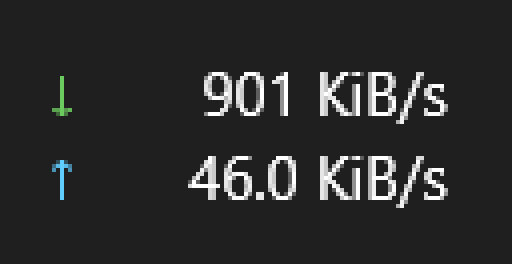

<h1 align="center">netspeed</h1>

<p align="center">
  <em>Live network speed, right on your Windows 11 taskbar. Native Rust. One tiny exe. No runtime, no installer, no nonsense.</em>
</p>

<p align="center">
  
  
  
  
  
</p>

<p align="center">
  
</p>

---

**netspeed** renders two compact lines onto the taskbar — download on top, upload below — with per-pixel transparency and antialiased text, drawn with Direct2D + DirectWrite. It works on all four taskbar edges, follows your DPI (Per-Monitor V2), respects your light/dark theme, and never steals focus or clicks.

## Features

- **Live ↓ / ↑ speeds** on the taskbar, updating every 250 ms – 5 s (your choice)
- **Smart adapter picking** — follows the OS best route (VPNs included), picks the busiest NIC automatically, or pin any adapter
- **Units & precision** — bits/s, SI bytes/s or binary (KiB/s); 0–2 decimals
- **CSV logging** — optional per-sample history with configurable retention
- **All 4 taskbar edges** — bottom, top, left, right, with proper text rotation
- **Light & dark theme** aware, Per-Monitor V2 DPI aware
- **Click-through & silent** — never overlaps or blocks taskbar clicks, no focus stealing
- **Single 310 KB exe**, no dependencies, no admin required
- **Tray menu** for everything — pause, interval, units, adapter, autostart, logs

## Screenshot

<p align="center">
  
</p>

## Install

1. Grab **`netspeed.exe`** from the [latest release](https://github.com/jamshidkhaksaar/netspeed/releases/latest)
2. Put it in a folder of your choice (e.g. `C:\Tools\NetSpeed\`) and run it
3. Windows 11 hides new tray icons — click the **`^`** chevron next to the clock and drag the netspeed icon onto the taskbar
4. Right-click the tray icon → **Start with Windows** if you want it always on

> The exe is unsigned, so SmartScreen may warn you the first time: **More info → Run anyway**.

## Settings

Everything lives in the tray icon's right-click menu:

| Menu item | Options |
|---|---|
| Update interval | 250 ms / 500 ms / 1 s / 2 s / 5 s |
| Units | bits/s · bytes/s SI · bytes/s binary |
| Decimals | 0 · 1 · 2 |
| Adapter | Automatic (best route) or any adapter |
| Save samples to CSV | on/off, daily files with retention |
| Start with Windows | on/off |
| Pause / Show widget / Open logs folder / Exit | — |

For a custom interval (anything from 250 ms to 60 s), edit `%APPDATA%\NetSpeed\config.json`:

```json
{
  "interval_ms": 500,
  "units": "bytes_bin",
  "decimals": 1,
  "adapter_luid": null,
  "logging": false,
  "log_retention_days": 30,
  "autostart": false,
  "show": true,
  "font_size": 12.0
}
```

Config lives in `%APPDATA%\NetSpeed\config.json`, CSV logs in `%APPDATA%\NetSpeed\logs\`.

## How it works

- The widget is a **layered child window of `Shell_TrayWnd`** — it lives inside the taskbar itself and is repositioned automatically when the taskbar moves, resizes or restarts
- Pixels are composed with **Direct2D** into a premultiplied-alpha DIB and pushed with `UpdateLayeredWindow`; text is rendered with **DirectWrite** using grayscale antialiasing
- Speeds come from the OS: **`GetIfTable2`** octet counters sampled on a timer, with the interface chosen by **`GetBestInterface`** (so VPN routing is honored) or manual pinning
- Zero hooks, zero injection, no admin rights. Manifest embeds Per-Monitor-V2 DPI awareness (required for layered child windows — see `build.rs`)

## Build from source

Requires [Rust](https://rustup.rs) (edition 2024, MSVC toolchain) and Visual Studio Build Tools with the Windows SDK.

```powershell
git clone https://github.com/jamshidkhaksaar/netspeed.git
cd netspeed
cargo build --release
# binary at target\release\netspeed.exe
```

Development helpers:

```powershell
netspeed.exe --debug-anchor   # dump taskbar/anchor window geometry
netspeed.exe --debug-net      # dump adapters and live rates
netspeed.exe --snap out.bmp   # save the widget's own pixels (with alpha) to a BMP
```

## FAQ

**The tray icon is missing.** Windows 11 hides new tray icons in the overflow (`^`). Drag it out, or enable it in *Settings → Personalization → Taskbar → Other system tray icons*.

**Speeds differ from my VPN client.** By default netspeed follows the OS best route, so with a full-tunnel VPN you'll see the VPN adapter's throughput — same traffic, slightly different numbers than the physical NIC due to encapsulation.

**Does it work on Windows 10?** No — netspeed targets Windows 11 only.

**Antivirus / SmartScreen warning?** The binary is unsigned. Build it yourself from source if you prefer.

## License

[MIT](LICENSE) © 2026 Jamshid Khaksaar

Inspired by the ideas of [TrafficMonitor](https://github.com/zhongyang219/TrafficMonitor) and [NetSpeedTray](https://github.com/erez-c137/NetSpeedTray). This is an original, from-scratch implementation — no code shared with those projects.
